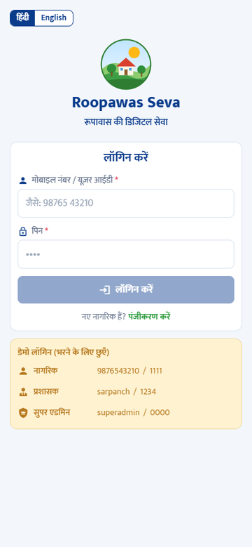
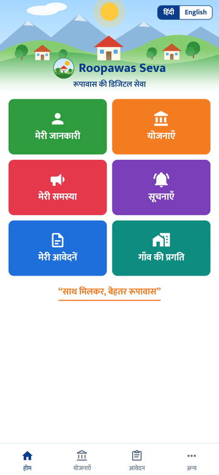
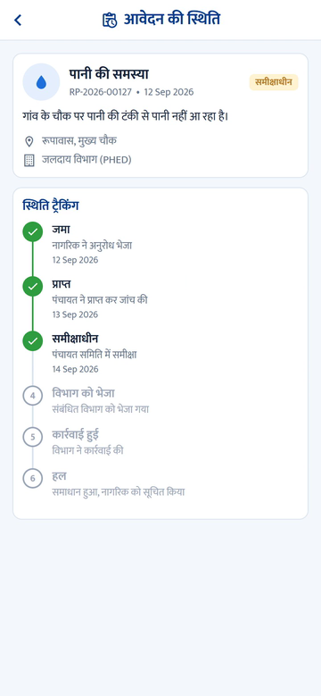
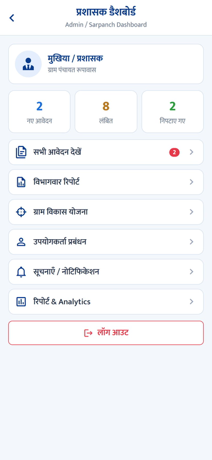
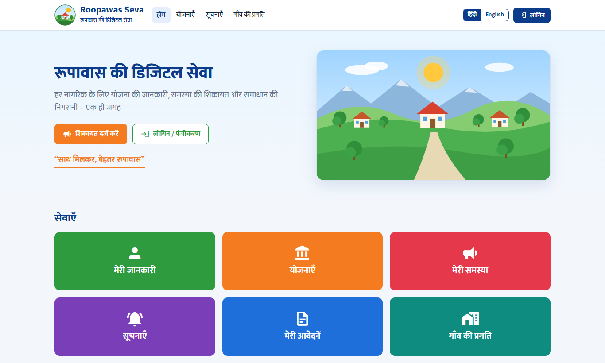
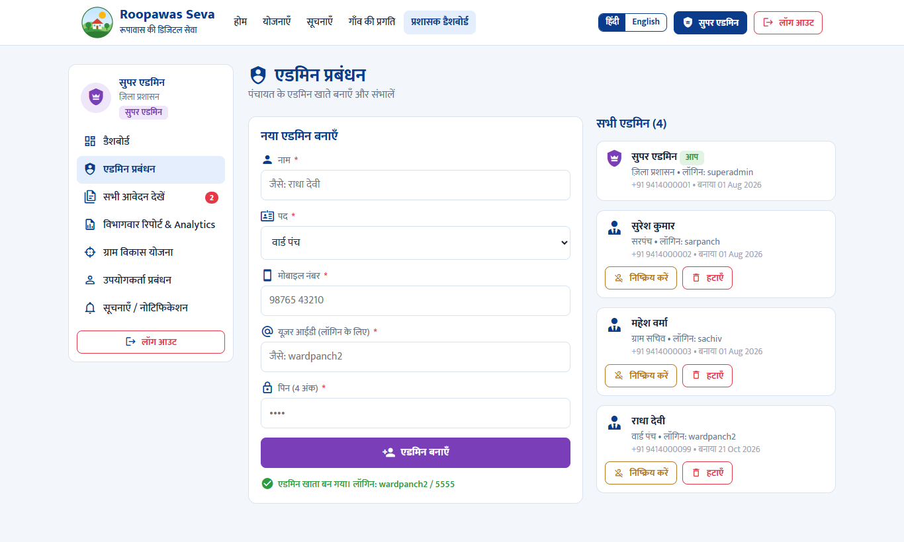

# Roopawas Seva – रूपावास की डिजिटल सेवा

> हर नागरिक के लिए योजना की जानकारी, समस्या की शिकायत और समाधान की निगरानी – एक ही जगह
>
> Scheme information, complaints and resolution tracking for every citizen of Roopawas – in one place.

A demo MVP of the digital service for Gram Panchayat Roopawas, built from the
[concept board](docs/concept-board.jpeg). It comes as two separate products that share the same
design, content and flows:

| | Folder | Built with |
| --- | --- | --- |
| **Mobile app** (Android APK) | [`app/`](app) | React Native · Expo SDK 57 · Expo Router |
| **Website** | [`web/`](web) | React 19 · Vite · React Router |

Both are bilingual (हिंदी / English toggle) and share one login for every role – citizens, admins
(Sarpanch / Panchayat staff) and the super admin. The account you log in with decides what you see.

▶ **[Watch the app walkthrough](docs/app-demo.mp4)** (2:41, no audio – recorded before the login and roles
were added, so it shows the earlier separate admin login)

<p>
  
  
  
  
</p>
<p>
  
  
</p>

## Features

**Login and roles**

| Role | Logs in with | Can |
| --- | --- | --- |
| Citizen | Mobile number + 4-digit PIN | Use all citizen services; sees only their own requests |
| Admin | User ID + PIN | Run the Panchayat panel below |
| Super admin | User ID + PIN | Everything an admin can, plus create, deactivate and remove admin accounts |

- One login screen for everyone; there is no separate admin button.
- The app opens on the login screen. On the website, information pages (home, schemes, notices,
  village dashboard) are public, and complaints, applications and the admin panel need a login.
- Deactivated accounts cannot log in. Admins can deactivate citizens; only the super admin manages admins.
- Each status change records which admin made it, and the citizen sees that in the timeline.

**Citizens**
- Registration: details → mobile OTP (simulated) → choose a login PIN
- Government schemes grouped by students, farmers, women, senior citizens and job seekers, with
  the citizen's own group shown first; apply in one tap
- Raise a complaint (category, description, photo, location) and get a request number such as
  `RP-2026-00128`
- Track every request through the six-step flow:
  Submitted → Received → Under Review → Forwarded → Action Taken → Resolved, then confirm the resolution
- Latest notices from the government and the Panchayat
- Public village dashboard (roads, water, street lights, schemes, total requests, development works)

**Sarpanch / admin**
- All applications: search by request number, name or mobile; filter by status, category,
  department and ward; sort by date or last update; see how long each request has been open
  (requests pending 15+ days are flagged). Filters stay in the URL, so a filtered list can be shared
- Update a request's status, department and a note for the citizen
- Department-wise report and analytics
- Citizen accounts
- Manage the content citizens see: publish, edit and remove notices; add, edit, close and remove
  schemes (a scheme with applications can only be closed); development works and their progress;
  and the recorded figures behind the public dashboard

## Quick start

Requires Node.js 20.19 or newer (22 LTS recommended).

```bash
# Website – http://localhost:5173
cd web
npm install
npm run dev

# Mobile app – dev server for Expo Go / a dev build
cd app
npm install
npm start
```

### Build the Android APK

Needs JDK 17 and the Android SDK (`ANDROID_HOME`).

```bash
cd app
npm run build:apk        # -> app/builds/roopawas-seva-<version>.apk (arm64-v8a)
```

The APK is signed with the debug key, so it can be installed on demo phones but not uploaded to
the Play Store. See [`app/README.md`](app/README.md) for details, including a Windows path-length
limit that affects native builds.

### Build the website

```bash
cd web
npm run build            # -> web/dist (static site; serve index.html for unknown paths)
```

## Demo walkthrough

Demo accounts (also listed on the login screen – tap/click one to fill it in):

| Role | Login | PIN |
| --- | --- | --- |
| Citizen (रामलाल शर्मा) | `9876543210` | `1111` |
| Admin (सरपंच) | `sarpanch` | `1234` |
| Admin (ग्राम सचिव) | `sachiv` | `2468` |
| Super admin | `superadmin` | `0000` |

1. On the login screen choose **पंजीकरण करें / Register**, fill in the details, enter any 4-digit
   OTP and pick a PIN. You are logged in as the new citizen.
2. Raise a complaint under **मेरी समस्या**, then follow it under **मेरी आवेदनें**. Log out
   (app: **अन्य** tab; website: header).
3. Log in as the super admin and open **एडमिन प्रबंधन / Admin management** to create a new admin.
4. Log in as that admin (or `sarpanch`), open the complaint, change its status and add a note.
5. Log back in as the citizen: the status, the note and who made the change are shown, and the
   village dashboard totals have updated.
6. **डेमो रीसेट करें / Reset demo** (app: **अन्य** tab; website: footer) restores the sample data
   and accounts.

## Current limitations

- **No backend yet.** All data is sample data stored on the device (AsyncStorage in the app,
  localStorage on the website). The app and website do not share data, and each phone or browser
  has its own copy.
- **Logins are for demonstration only.** OTP is simulated, and accounts and PINs are stored in plain
  text on the device. Real authentication needs the backend.
- Notifications are simulated.
- The logo, banner and app icon are placeholder artwork (`*/src/components/Art.tsx`,
  `app/assets/`) until the final assets are ready.
- The website already loads all data through an API layer (`web/src/api`), backed for now by a
  mock server in the browser; the planned Express + MongoDB backend will implement the same API.
  The mobile app still uses its older on-device store and will be rebuilt on the backend.

## Repository layout

```
app/    React Native mobile app (Expo)
web/    React website (Vite)
docs/   Concept board, app walkthrough video, screenshots
```
