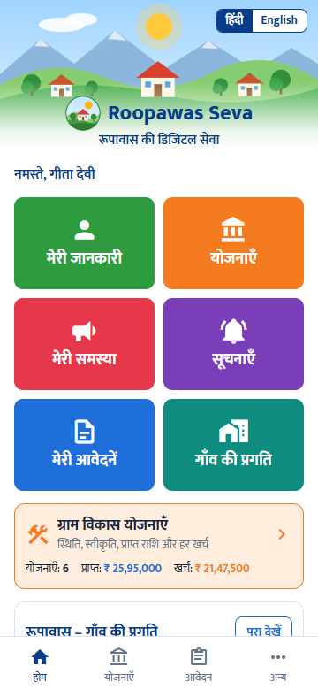
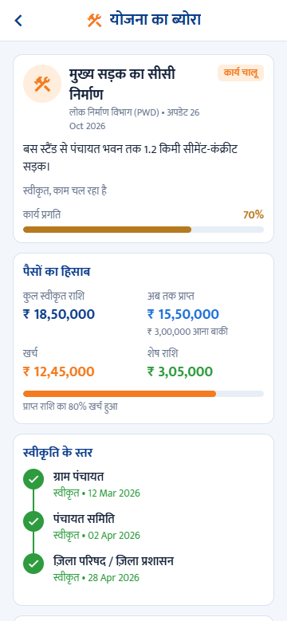
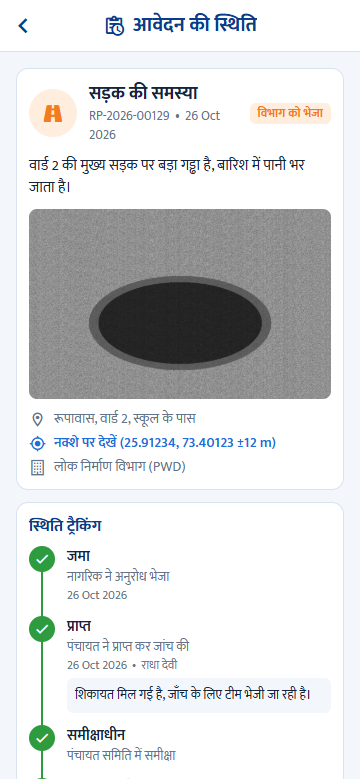
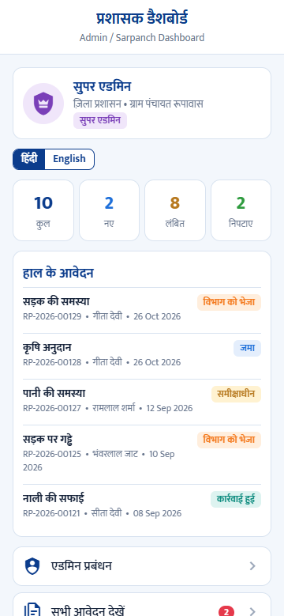
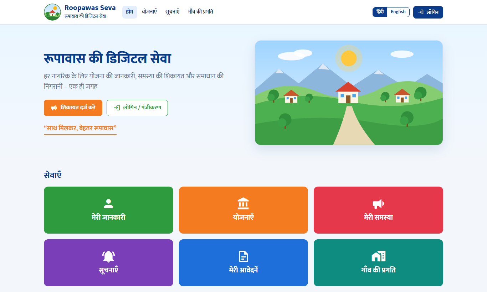
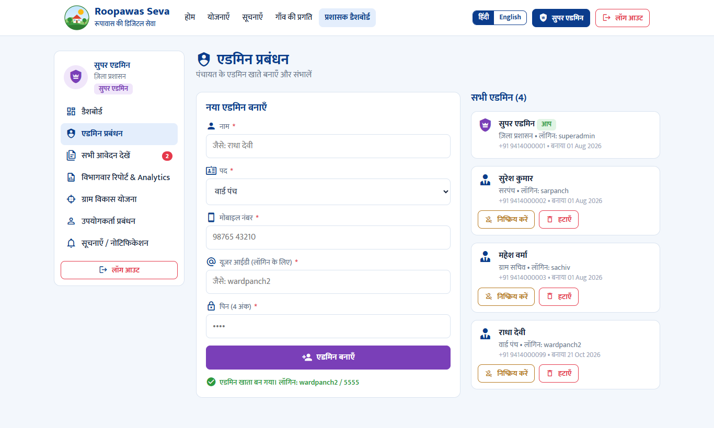

# Roopawas Seva – रूपावास की डिजिटल सेवा

> हर नागरिक के लिए योजना की जानकारी, समस्या की शिकायत और समाधान की निगरानी – एक ही जगह
>
> Scheme information, complaints and resolution tracking for every citizen of Roopawas – in one place.

A demo MVP of the digital service for Gram Panchayat Roopawas, built from the
[concept board](docs/concept-board.jpeg). It comes as two separate products that share the same
design, content and flows:

| | Folder | Built with |
| --- | --- | --- |
| **Mobile app** (Android APK) | [`app/`](app) | React Native · Expo SDK 57 · Expo Router |
| **Website** | [`web/`](web) | React 19 · Vite · React Router |

Both are bilingual (हिंदी / English toggle), have the same features, and talk to the same backend
([`server/`](server)) through one API contract in [`shared/`](shared). They share one login for every role –
citizens, admins (Sarpanch / Panchayat staff) and the super admin. The account you log in with decides what you see.

▶ **[Watch the app walkthrough](docs/app-demo.mp4)** (6:08, no audio): a visitor browsing, Village Yojnas,
registration, a complaint with photo and GPS, the super admin creating an admin, that admin working the
complaint and managing content and yojnas, and the citizen seeing the update.

<p>
  
  
  
  
</p>
<p>
  
  
</p>

## Features

**Login and roles**

| Role | Logs in with | Can |
| --- | --- | --- |
| Citizen | Mobile number + 4-digit PIN | Use all citizen services; sees only their own requests |
| Admin | User ID + PIN | Run the Panchayat panel below |
| Super admin | User ID + PIN | Everything an admin can, plus create, deactivate and remove admin accounts |

- One login screen for everyone; there is no separate admin button.
- Information (home, schemes, notices, village dashboard, Village Yojnas, help) is public in both the
  app and the website; complaints, applications and the admin panel need a login.
- Deactivated accounts cannot log in. Admins can deactivate citizens; only the super admin manages admins.
- Each status change records which admin made it, and the citizen sees that in the timeline.

**Citizens**
- Registration: details → mobile OTP (simulated) → choose a login PIN
- Government schemes grouped by students, farmers, women, senior citizens and job seekers, with
  the citizen's own group shown first; apply in one tap
- Raise a complaint (category, description, photo, address and optional GPS location) and get a request
  number such as `RP-2026-00128`. Photos are compressed on the device (a phone photo becomes ~100–350 KB)
- Track every request through the six-step flow:
  Submitted → Received → Under Review → Forwarded → Action Taken → Resolved, then confirm the resolution,
  or reopen it with a reason within 30 days if the problem is not actually fixed
- Latest notices from the government and the Panchayat, with their dates
- Public village dashboard (roads, water, street lights, schemes, total requests, village Yojnas)
- **Village Yojnas**, open to everyone: each development yojna's status (Proposed, Processing, On hold,
  Active, Completed), which approval level it is waiting on (e.g. Panchayat Samiti → District → State),
  the money sanctioned by each source (central, state, district, MP/MLA fund…), the instalments received,
  and every expense with its category and a photo of the bill
- Help page: how to use the service and frequently asked questions

**Sarpanch / admin**
- All applications: search by request number, name or mobile; filter by status, category,
  department and ward; sort by date or last update; see how long each request has been open
  (requests pending 15+ days are flagged). On the website, filters stay in the URL, so a filtered list can be shared
- Update a request's status, department and a note for the citizen
- Department-wise report and analytics
- Citizen accounts
- Manage the content citizens see: publish, edit and remove notices; add, edit, close and remove
  schemes (a scheme with applications can only be closed); and the recorded figures behind the public dashboard
- Village Yojnas: create a yojna and set its approval levels, keep its status and progress current, record
  funds, instalments (never more than sanctioned) and expenses with bill photos. Needs the backend; the
  offline demo data (website mock, app without a server) does not have it

## Quick start

Requires Node.js 20.19 or newer (22 LTS recommended).

```bash
# Backend – http://localhost:4000 (copy server/.env.example to server/.env and fill it in first)
cd server
npm install
npm run seed             # demo data (DEMO_MODE=true); or `npm run setup` for a real database
npm run dev

# Website – http://localhost:5173 (copy web/.env.example to web/.env so it uses the backend;
# without it the website runs on a built-in mock with sample data in the browser)
cd web
npm install
npm run dev

# Mobile app – dev server for a dev build. Uses the live API (app/.env); override in app/.env.local, e.g.
# EXPO_PUBLIC_API_URL=http://192.168.1.20:4000 (the computer's address on the Wi-Fi – a phone cannot reach
# "localhost"), or EXPO_PUBLIC_API_URL= (empty) for built-in sample data saved on the phone
cd app
npm install
npm start
```

### Build the Android APK

Needs JDK 17 and the Android SDK (`ANDROID_HOME`).

```bash
cd app
npm run build:apk        # -> app/builds/roopawas-seva-<version>.apk (arm64-v8a)
```

The APK uses the backend whose address is in `EXPO_PUBLIC_API_URL` when it is built: `https://api.roopawas.in`
from `app/.env`, unless `app/.env.local` overrides it. Built with it empty, it is a self-contained demo on sample
data stored on the phone (everything except Village Yojnas, which need the server). With a server, the app shows a
*No internet connection* page while the phone is offline and continues by itself when the connection returns.

The APK is signed with the debug key, so it can be installed on demo phones but not uploaded to
the Play Store. See [`app/README.md`](app/README.md) for details, including a Windows path-length
limit that affects native builds.

### Build the website

```bash
cd web
npm run build            # -> web/dist (static site; serve index.html for unknown paths)
```

## Demo walkthrough

Demo accounts (also listed on the login screen – tap/click one to fill it in):

| Role | Login | PIN |
| --- | --- | --- |
| Citizen (रामलाल शर्मा) | `9876543210` | `1111` |
| Admin (सरपंच) | `sarpanch` | `1234` |
| Admin (ग्राम सचिव) | `sachiv` | `2468` |
| Super admin | `superadmin` | `0000` |

1. Choose **लॉगिन / पंजीकरण करें – Log in / Register**, then **पंजीकरण करें / Register**, fill in the details, enter any 4-digit
   OTP and pick a PIN. You are logged in as the new citizen.
2. Raise a complaint under **मेरी समस्या**, then follow it under **मेरी आवेदनें**. Log out
   (app: **अन्य** tab; website: header).
3. Log in as the super admin and open **एडमिन प्रबंधन / Admin management** to create a new admin.
4. Log in as that admin (or `sarpanch`), open the complaint, change its status and add a note.
5. Log back in as the citizen: the status, the note and who made the change are shown, and the
   village dashboard totals have updated.
6. **डेमो रीसेट करें / Reset demo** (app: **अन्य** tab; website: footer) restores the sample data
   and accounts.

## Current limitations

- **Not deployed yet.** The website, the app and the backend (`server/`, Express + MongoDB Atlas) work
  together locally. For phones to use the backend it must be reachable from them (same Wi-Fi for now).
- **No SMS provider yet.** Outside demo mode, registration OTPs are written to the server log.
- **The offline demo data** (website mock, app without a server) keeps accounts and PINs in plain text on
  the device, for demos only. With the backend, PINs are stored hashed and logins are real.
- Notifications are simulated.
- The logo, banner and app icon are placeholder artwork (`*/src/components/Art.tsx`,
  `app/assets/`) until the final assets are ready.

## Repository layout

```
web/     React website (Vite)
server/  Backend API (Express + MongoDB), being built
shared/  Types, rules, API contract and sample data used by web, server and app
app/     React Native mobile app (Expo)
docs/    Concept board, app walkthrough video, screenshots
```
