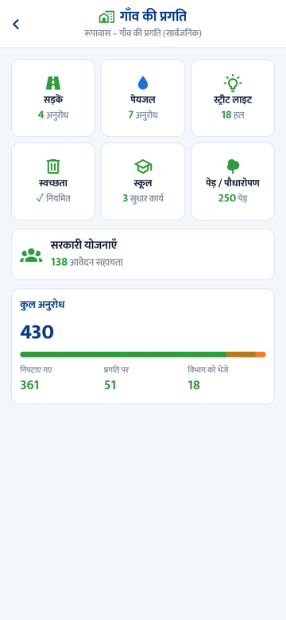
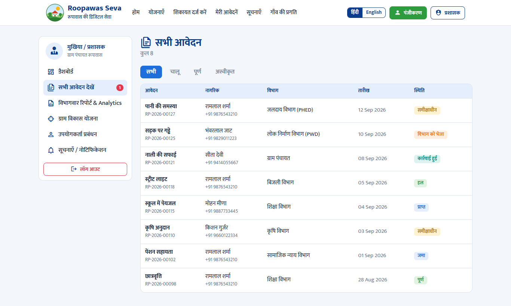

# Roopawas Seva – रूपावास की डिजिटल सेवा

> हर नागरिक के लिए योजना की जानकारी, समस्या की शिकायत और समाधान की निगरानी – एक ही जगह
>
> Scheme information, complaints and resolution tracking for every citizen of Roopawas – in one place.

A demo MVP of the digital service for Gram Panchayat Roopawas, built from the
[concept board](docs/concept-board.jpeg). It comes as two separate products that share the same
design, content and flows:

| | Folder | Built with |
| --- | --- | --- |
| **Mobile app** (Android APK) | [`app/`](app) | React Native · Expo SDK 57 · Expo Router |
| **Website** | [`web/`](web) | React 19 · Vite · React Router |

Both are bilingual (हिंदी / English toggle) and include the citizen side and the
Sarpanch / admin side.

▶ **[Watch the app walkthrough](docs/app-demo.mp4)** (2:41, no audio)

<p>
  
  
  
  
</p>
<p>
  
  
</p>

## Features

**Citizens**
- One-time registration with mobile OTP (simulated)
- Government schemes grouped by students, farmers, women, senior citizens and job seekers, with
  the citizen's own group shown first; apply in one tap
- Raise a complaint (category, description, photo, location) and get a request number such as
  `RP-2026-00128`
- Track every request through the six-step flow:
  Submitted → Received → Under Review → Forwarded → Action Taken → Resolved, then confirm the resolution
- Latest notices from the government and the Panchayat
- Public village dashboard (roads, water, street lights, schemes, total requests)

**Sarpanch / admin**
- All applications with filters; update a request's status, department and a note for the citizen
- Department-wise report and analytics
- Village development plan, user list, and publishing notices

## Quick start

Requires Node.js 20.19 or newer (22 LTS recommended).

```bash
# Website – http://localhost:5173
cd web
npm install
npm run dev

# Mobile app – dev server for Expo Go / a dev build
cd app
npm install
npm start
```

### Build the Android APK

Needs JDK 17 and the Android SDK (`ANDROID_HOME`).

```bash
cd app
npm run build:apk        # -> app/builds/roopawas-seva-<version>.apk (arm64-v8a)
```

The APK is signed with the debug key, so it can be installed on demo phones but not uploaded to
the Play Store. See [`app/README.md`](app/README.md) for details, including a Windows path-length
limit that affects native builds.

### Build the website

```bash
cd web
npm run build            # -> web/dist (static site; serve index.html for unknown paths)
```

## Demo walkthrough

1. Register under **मेरी जानकारी / My Profile**. Use any valid 10-digit mobile number and any
   4-digit OTP.
2. Raise a complaint under **मेरी समस्या**, then follow it under **मेरी आवेदनें**.
3. Log in as the Sarpanch with **`sarpanch` / `1234`** (app: **अन्य → मुखिया / प्रशासक लॉगिन**;
   website: **प्रशासक**), open the complaint, change its status and add a note.
4. Back on the citizen side, the status, the note and the village dashboard totals have updated.
5. **डेमो रीसेट करें / Reset demo** (app: **अन्य** tab; website: footer) restores the sample data.

## Current limitations

- **No backend yet.** All data is sample data stored on the device (AsyncStorage in the app,
  localStorage on the website). The app and website do not share data, and each phone or browser
  has its own copy.
- OTP, notifications and the admin login are simulated; the admin credentials above are for the
  demo only.
- The logo, banner and app icon are placeholder artwork (`*/src/components/Art.tsx`,
  `app/assets/`) until the final assets are ready.
- The sample data and rules (`data.ts`, `store.ts`, `filters.ts`, `stats.ts`) are duplicated in
  `app/src` and `web/src`; keep both in sync until they move behind an API.

## Repository layout

```
app/    React Native mobile app (Expo)
web/    React website (Vite)
docs/   Concept board, app walkthrough video, screenshots
```
